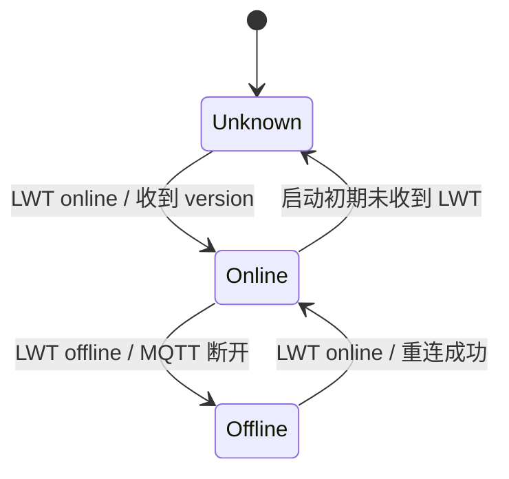
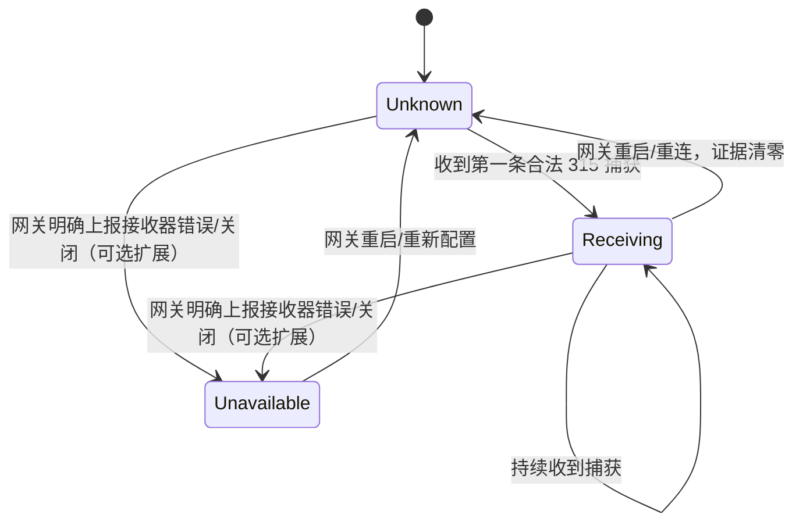
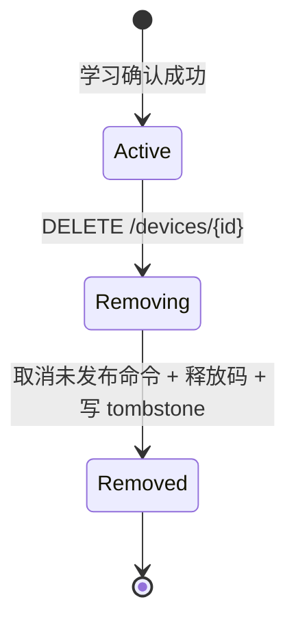
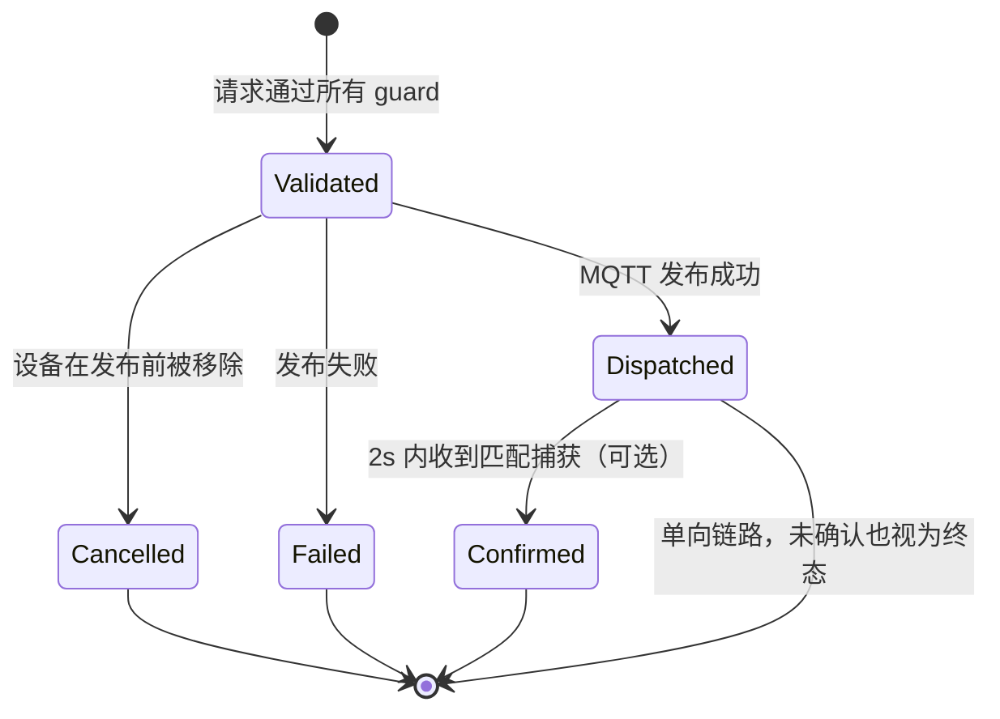
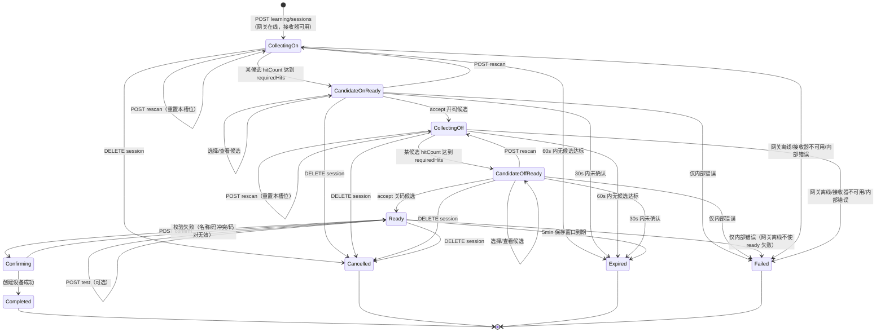

# ESP32 Control 接口、状态机与数据流契约 v1

- 状态：**已实现**（contract v1.1.0）
- 日期：2026-11-03
- 适用端：`server`（Ktor + Kotlin/Native）、`androidApp`、`webApp`
- 覆盖范围：**控制设备开关、学习新设备、移除旧设备**，以及三者依赖的
  网关状态机、设备生命周期、命令状态机、学习会话状态机和事件数据流

> 本文定义协议与状态机。DTO、枚举、SSE 事件与 `ContractJson` 已落在
> [`contract`](../contract) 模块，服务端路由与 UI 均以该模块为准；
> 文中 Kotlin 片段用于说明字段形状，可能与源码略去私有实现细节。

---

## 0. 摘要

系统里同时存在四个核心状态机，服务端是业务状态权威；网关侧另有接收器状态，
决定 RF 信号能否进入系统：

| 状态机 | 作用 | 影响 |
| --- | --- | --- |
| 网关连接状态机 | MQTT/LWT 决定网关是否在线 | 控制与学习的前置条件 |
| 网关接收器状态 | 315MHz 接收器是否在工作、是否上报过信号 | 学习的信号来源；没有它就没有捕获 |
| 设备生命周期 | `active → removed`（内部含 `removing`） | 控制是否允许、码资源是否释放 |
| 命令状态机 | 校验 → 发布 → 可选确认/失败/取消 | 开关动作是否真正下发 |
| 学习会话状态机 | 采集开码 → 候选确认 → 采集关码 → 候选确认 → 待保存 | 新设备如何被发现、确认、入库 |

三个核心结论：

1. **开关控制是“显式动作 + 命令状态机”**，不是 `toggle`。命令被接受（202）
   只代表已下发，315MHz 单向链路不保证物理确认。
2. **学习是跨端协作，不是服务端单独完成的**。315MHz 接收器在网关上，
   网关负责实际接收空中信号并通过 `315toMQTT` 上报；服务端负责打开采集窗口、
   把重复帧聚类成“按键次数”、生成候选码，客户端负责确认候选码的 ON/OFF 语义并命名入库。
   **没有网关捕获，就没有学习。** OMG 315 没有独立的“学习模式”指令，接收器通常常开；
   因此服务端的“开始学习”不是给网关下学习命令，而是开启一个服务端关联窗口，
   消费网关持续上报的 RX 流。
   服务端只识别“哪个码被重复按了 3 次”，**不猜测它是开还是关**；开/关由客户端交互确认。
3. **移除是服务端生命周期终止**：立即拒绝新命令、取消未发布命令、
   释放开/关码、保留 tombstone，并通知所有客户端；不会向网关发送“删除”指令。

接口速查：

| 方法 | 路径 | 成功 | 用途 |
| --- | --- | --- | --- |
| `GET` | `/api/v1/health` | `200 HealthResponse` | 服务/网关状态 |
| `GET` | `/api/v1/devices` | `200 DeviceListResponse` | 设备列表（不含已移除） |
| `GET` | `/api/v1/devices/{id}` | `200 Device` | 单设备；已移除返回 `410` |
| `POST` | `/api/v1/devices/{id}/commands` | `202 CommandAccepted` | 控制开关 |
| `GET` | `/api/v1/commands/{commandId}` | `200 CommandRecord` | 查询命令状态 |
| `DELETE` | `/api/v1/devices/{id}` | `204` | 移除设备 |
| `POST` | `/api/v1/learning/sessions` | `201 LearningSession` | 开始学习（先采集开码） |
| `GET` | `/api/v1/learning/sessions/{id}` | `200 LearningSession` | 轮询学习状态 |
| `POST` | `/api/v1/learning/sessions/{id}/candidates/{candidateId}/accept` | `200 LearningSession` | 确认当前槽位的候选码 |
| `POST` | `/api/v1/learning/sessions/{id}/rescan` | `200 LearningSession` | 丢弃当前槽位候选并重新采集 |
| `POST` | `/api/v1/learning/sessions/{id}/test` | `202 LearningTestResult` | 试发已确认的码 |
| `POST` | `/api/v1/learning/sessions/{id}/confirm` | `201 LearningConfirmation` | 命名并保存新设备 |
| `DELETE` | `/api/v1/learning/sessions/{id}` | `204` | 取消学习 |
| `GET` | `/api/v1/events` | `200 text/event-stream` | SSE 状态/抓码事件 |

---

## 1. 角色、术语与边界

### 1.1 角色

```
┌──────────┐   HTTP/JSON/SSE   ┌──────────────┐   MQTT   ┌───────────┐  315MHz RF  ┌────────┐
│ Android  │ ◄───────────────► │    Server    │ ◄──────► │  Gateway  │ ◄─────────► │ Remote │
│   Web    │                   │ Kotlin/Native│          │  ESP32    │             │ Button │
└──────────┘                   └──────────────┘          └───────────┘             └────────┘
                                    │ 设备注册表/命令/学习会话
                                    ▼
                              contract (KMP)
```

- **Gateway**：OpenMQTTGateway v1.7+，负责 315MHz 无线收发和 MQTT 桥接。
  它不保存设备名称、设备 ID 或学习会话，但它的 **315MHz 接收器是学习的唯一信号来源**：
  接收器收到遥控器信号后，解码为 `value/protocol/length/delay` 并发布到
  `315toMQTT`。服务端不能凭空生成或“推断”一个 RF 码。
- **Remote**：315MHz 遥控器/按钮，一个按键对应一个 RF 码；物理链路单向。
- **Server**：唯一拥有设备注册表、开/关码归属、命令记录、学习会话的服务端；
  它编排采集/候选确认窗口，但必须等待网关捕获。
- **Client**：Android/Web，负责交互和本地展示；不得自行推断服务端状态，
  也不能直接提交 RF 码。

### 1.2 关键术语

| 术语 | 含义 |
| --- | --- |
| RF 码 | `(protocol, length, value)` 三元组，例如 `(1, 24, 1714739)` |
| 开码 / 关码 | 一个逻辑设备绑定的两个 RF 码；分别用于 `turn_on` / `turn_off` |
| 捕获 | 网关的 315MHz 接收器从空中收到并解码的 RF 码，经 `315toMQTT` 上报 |
| 候选码 | 学习会话中按 `(protocol,length,value)` 聚合的码；达到按键次数阈值后才可被接受，仍需客户端确认语义 |
| 按键次数 | 同一候选码被独立按下（而不是同一按键产生的重复帧）的次数 |
| 采集窗口 | 服务端为当前槽位打开的 60 秒关联窗口；窗口内到达的网关捕获才计入 |
| 候选确认窗口 | 候选码达到阈值后，等待客户端确认的 30 秒窗口 |
| 学习会话 | 一个有 TTL 的服务端状态机，依次采集开码、确认开码、采集关码、确认关码，最后等待命名保存 |
| 接收器就绪 | 网关在线且接收器可用；`receiving` 表示至少观察到过一次捕获 |
| 命令 | 一次显式控制请求，拥有 `commandId` 和状态 |
| tombstone | 设备移除后的墓碑记录，用于幂等、审计和 `410` |
| revision | 实体版本号，每次变更递增，用于事件排序与客户端去旧 |

### 1.3 单向链路假设

315MHz 遥控通常是**单向**的：发射后没有协议层 ACK。

因此：

- `202` 只能表示“服务端已接受并尝试下发”，不能表示“设备已执行”。
- 网关通常不会把自己刚发射的码回显到 `315toMQTT`；即使回显，也无法区分
  是本次命令还是用户按了遥控器。
- 设备的 `state` 是**服务端最佳已知状态**，不是传感器读数。
  通过 `stateEvidence` 明确它是“已上报”还是“仅命令推断”。

---

## 2. 数据流总览

### 2.1 正常控制（无学习）

```
Client ──POST command──► Server
                          ├─ 校验网关/设备/命令状态
                          ├─ 创建 CommandRecord
                          ├─ 发布 MQTTto315 {value, protocol, length, repeat}
                          ├─ 设备 state 标记为 commanded（乐观）
                          └─ 返回 202 + 更新后的 Device
Server ──SSE command.updated / device.updated──► 所有 Client
Gateway ──315toMQTT（可选，若收到）──► Server ──可选确认──► CommandRecord.confirmed
```

### 2.2 学习新设备

学习不是服务端凭空完成的。真正的信号接收发生在网关：

```
Gateway Receiver（315MHz）: 常开监听
        │ 收到遥控器信号（一次按键可能产生多帧重复）
        ▼
Gateway: 解码为 value/protocol/length/delay，发布 315toMQTT
        │
        ▼
Server: 常驻订阅捕获主题，维护最近捕获与接收器证据
        │
Client ──POST learning/sessions──► Server（state=collecting_on，开码采集窗口 60s）
        │                              │
        │                              ├─ 不向网关发“学习命令”（OMG 315 无此指令）
        │                              └─ 只把窗口内到达的捕获关联到会话
User 连续按遥控器开键 3 次
Remote ──RF──► Gateway Receiver ──315toMQTT──► Server
Server: 按 (protocol,length,value) 聚类
        ├─ 400ms 内的重复帧 = 同一次按键，不增加 hitCount
        ├─ 与上次同码间隔 ≥600ms = 新的一次按键，hitCount++
        └─ hitCount 1/3 → 2/3 → 3/3
Server: 候选达到 requiredHits=3 → state=candidate_on_ready（停止开码采集，确认窗口 30s）
Server ──SSE learning.updated──► Client（展示候选码、按键次数、冲突信息）
Client: 选择候选码并确认它是“开” ──POST .../candidates/{id}/accept──► Server
Server: state=collecting_off（关码采集窗口 60s）
User 连续按遥控器关键 3 次
Remote ──RF──► Gateway Receiver ──315toMQTT──► Server
Server: 同一套聚类 → 候选达到 3 次 → state=candidate_off_ready
Client: 确认候选码是“关” ──POST .../candidates/{id}/accept──► Server
Server: state=ready（保留两个已接受的候选码，保存窗口 5min）
Client ──POST confirm {name, location}──► Server
Server: 校验已接受的开/关候选码、冲突、协议/位宽 → 创建设备 → 写入码归属 → completed
Server ──SSE learning.updated + device.added──► Client
```

关键点：

- **网关接收器必须工作**。接收器未启用、天线未接、频率不对、距离太远或网关断电，
  服务端就收不到捕获，学习只能超时；服务端无法替代或伪造这一步。
- OpenMQTTGateway 315 通常**没有独立的“进入学习模式”MQTT 指令**；接收器在启动时
  就常开，所有解码到的码都会上报。服务端的“开始学习”只是打开一个**关联窗口**，
  不是让网关开始接收。
- **一次物理按键往往对应多帧 MQTT 捕获**。因此“按 3 次”必须按独立按键组计数，
  不能把 3 条重复帧当成 3 次按键；否则一次长按就会误判为候选。
- 服务端只负责“发现重复出现的码”，**不自动判断它是开还是关**。开/关语义由客户端
  在当前槽位的候选卡片上确认；有多个候选时由用户选择，避免噪声码被自动绑定。
- 网关不知道 `sessionId`，也不保存学习状态；v1 单网关、单活动会话，
  服务端用**时间窗口 + 主题 + 候选 ID**把捕获关联到会话。
- 客户端不能直接 POST 一个 RF 码；唯一合法的捕获来源是网关的 `315toMQTT`。
- 若未来固件增加“学习模式/接收器武装”指令，可作为可选扩展；v1 不依赖它。

### 2.3 移除旧设备

```
Client ──DELETE device──► Server
Server: active → removing
        ├─ 拒绝新命令
        ├─ 取消尚未发布的命令
        ├─ 从码归属索引删除 codeOn/codeOff
        ├─ 从设备列表移除
        ├─ 写 tombstone（保留 24h）
        └─ removing → removed
Server ──SSE device.removed──► 所有 Client
```

移除**不发送 MQTT 消息**。网关没有“忘记设备”的概念；移除只是服务端不再
承认该设备和码归属。网关接收器仍然常开，继续上报空中的码。

### 2.4 数据流因本次协议发生的变化

| 变化 | 之前 | 之后 |
| --- | --- | --- |
| MQTT 订阅 | 服务端未接入 MQTT | 必须常驻订阅 `315toMQTT`、LWT、version |
| 捕获处理 | 无 | 网关接收器上报 → 服务端归一化/按按键分组/聚合候选 |
| 学习信号来源 | 无 | **只来自网关 315MHz 接收器**；服务端不生成 RF 码 |
| 客户端更新 | 请求后手动刷新/30s 轮询 | SSE 推送 + revision 校正；轮询作为降级 |
| 设备创建 | 启动时两条内存演示数据 | 学习确认后动态创建 |
| 设备删除 | 无 | `DELETE` + tombstone + 码释放 |
| 开关语义 | `POST toggle` | `POST commands` + 显式动作 + 命令状态 |
| 设备状态 | `on: Boolean` | `state` + `stateEvidence`（reported/commanded/unknown） |
| 码资源 | 仅展示 | 全局码归属索引，学习时做冲突检测 |

---

## 3. 共享 contract 模块

### 3.1 模块职责

新增 `contract` KMP 模块，三端共用：

- 所有 HTTP DTO、SSE 事件类型、枚举
- 路由/Header/错误码常量
- 唯一 `ContractJson` 配置
- 学习/命令/设备状态枚举及转换规则（纯常量与类型，不含业务逻辑）

不放入 `contract`：

- Ktor `HttpClient`、SSE 客户端实现
- Compose UI、中文文案
- MQTT 客户端
- 服务端设备注册表、命令执行器、学习管理器

### 3.2 目标平台

| Target | 消费者 | 说明 |
| --- | --- | --- |
| `linuxArm64` | `server` | 现有部署目标 |
| `macosArm64` | `server`（可选） | 与 `-PenableMacosServer=true` 联动 |
| `androidLibrary` | `shared` / `androidApp` | AGP 9 KMP library 插件 |
| `wasmJs` | `shared` / `webApp` | 库 + browser 目标 |

`contract` 的 `commonMain` 只依赖 `kotlinx-serialization-core/json`。
Android 目标继续使用 `kotlin { androidLibrary { ... } }`，
应用模块 `androidApp` 保持纯 `com.android.application` + 内置 Kotlin。

### 3.3 依赖方向

```
server ─────────────┐
                    ├──► contract
shared ─────────────┘
  ├──► androidApp
  └──► webApp
```

- 服务端：`implementation(project(":contract"))`
- `shared`：`api(project(":contract"))`，让两个 GUI 都能使用 DTO
- 禁止在 `server` 与 `shared` 各维护一份同名模型

### 3.4 服务端内部模块（建议，不要求同进程分层）

```
MQTT Ingest ──► CaptureNormalizer / PressClusterer ──► LearningManager
                                              └─► EventBus
HTTP Routes ──► DeviceRegistry / CommandExecutor / LearningManager
DeviceRegistry ──► CodeOwnershipIndex
CommandExecutor ──► MqttPublisher
```

状态机逻辑放在服务端领域服务中，不放在 HTTP 路由或客户端。

---

## 4. 传输通用约定

### 4.1 Base URL 与版本

- 所有接口：`/api/v1`
- 开发端口：`8080`
- Android 模拟器：`http://10.0.2.2:8080/api/v1`
- Web：`http://<页面 host>:8080/api/v1`
- 生产 Web：同源反向代理，客户端使用相对路径 `/api/v1`
- 旧 `/api` 路由仅作迁移兼容，最终删除

### 4.2 JSON 与时间

| 规则 | 约定 |
| --- | --- |
| Media type | `application/json; charset=utf-8`；SSE 为 `text/event-stream` |
| 字段名 | `lowerCamelCase`，与 Kotlin 属性名一致 |
| 枚举 | 线上小写 snake_case，`@SerialName` 固定 |
| 时间 | UTC epoch milliseconds，`Long`，字段以 `EpochMs` 结尾 |
| ID | 不透明字符串；客户端不得解析 |
| 可空 | 明确输出 `null`，不用空字符串代替 |
| 未知字段 | 客户端/服务端均忽略（`ignoreUnknownKeys = true`） |

`ContractJson`：

```kotlin
val ContractJson = Json {
    ignoreUnknownKeys = true
    encodeDefaults = true
    explicitNulls = true
    isLenient = false
    prettyPrint = false
}
```

### 4.3 Header

| Header | 方向 | 必填 | 说明 |
| --- | --- | --- | --- |
| `Accept` | 请求 | 建议 | `application/json` 或 `text/event-stream` |
| `Content-Type` | 请求 | POST 必填 | `application/json` |
| `X-Request-Id` | 请求 | 否 | 客户端可传；服务端回显 |
| `Idempotency-Key` | 请求 | 命令必填 | 1–64 字符 |
| `X-Request-Id` | 响应 | 是 | 服务端生成/回显 |
| `Cache-Control` | 响应 | 是 | API 为 `no-store`；SSE 为 `no-cache` |
| `Idempotent-Replayed` | 响应 | 否 | `true` 表示命中了幂等缓存 |

### 4.4 幂等

- `POST /devices/{id}/commands` 必须带 `Idempotency-Key`。
- 同一 key + 同请求体，10 分钟内不重复发布；返回当前命令记录与当前设备快照。
- 同一 key + 不同请求体 → `409 idempotency_conflict`。
- `turn_on` / `turn_off` 本身是幂等动作，即使缓存丢失，重发同一个码也不会反转状态。
- 不使用 `toggle`。
- `DELETE` 天然幂等：重复删除返回 `204`（墓碑存在时）。

### 4.5 超时与限制

| 项 | 值 |
| --- | --- |
| 客户端请求超时 | 10 s |
| 命令发布超时 | 3 s |
| 幂等缓存 TTL | 10 min |
| 单个槽位采集窗口 | 60 s |
| 候选确认窗口 | 30 s |
| `ready` 保存窗口 | 5 min |
| 学习会话总时长 | 10 min（进入 `ready` 后重置为 5 min） |
| 判定候选所需独立按键次数 | 3 次（`requiredHits`，服务端策略） |
| 同一按键的帧合并窗口 | 400 ms |
| 新按键最小间隔 | 600 ms |
| 学习候选上限 | 每会话 32 个（含历史槽位） |
| 抓码去重窗口 | 400 ms（与按键帧合并窗口一致） |
| 设备 tombstone 保留 | 24 h（可配置） |
| 学习会话终态保留 | 5 min（之后 `404`） |
| SSE 重放缓冲 | 256 条 / 5 min |

### 4.6 CORS 与安全边界

- 开发：允许 `*`；生产：Origin 白名单。
- 方法：`GET, POST, DELETE, OPTIONS`。
- 请求头：`Accept, Content-Type, Idempotency-Key, X-Request-Id, Last-Event-ID`。
- 暴露头：`X-Request-Id`、`Idempotent-Replayed`。
- 不使用 Cookie/凭据（v1）。
- v1 无鉴权，仅限可信局域网；远程部署必须加认证与 TLS。
- 学习/控制/删除都是高风险写操作，后续必须做权限控制与审计。

---

## 5. 状态机

> 业务状态机由服务端强制；客户端只做显示和按钮禁用。
> 网关接收器状态由网关硬件/固件决定，服务端只能观察和推断，不能替代。
> 服务端状态转换必须原子执行（设备级/全局学习锁），并在转换后发出事件。

### 5.1 网关连接状态机



| 状态 | 含义 | 控制 | 学习 |
| --- | --- | --- | --- |
| `unknown` | 启动后尚未确认 | 拒绝（503） | 拒绝（503） |
| `online` | LWT=online 且 MQTT 已连接 | 允许 | 允许 |
| `offline` | LWT=offline 或连接断开 | 拒绝（503） | 拒绝（503） |

规则：

- 网关状态来自 `home/OpenMQTTGateway/LWT`，不是客户端上报。
- 网关离线时，所有设备 `online=false`，但设备仍保留在列表中。
- 网关在采集阶段离线 → 当前学习会话转 `failed`，原因 `gateway_offline`；
  已进入候选确认或 `ready` 的会话不受影响（证据已收到），但试发仍需网关在线。
- 命令在发布时网关离线 → 不创建成功命令，返回 `503 gateway_unavailable`。
- 网关恢复后不会自动重放命令/学习；用户需重新操作。

### 5.1.1 网关接收器状态（学习的信号来源）

连接在线不等于接收器一定在工作。接收器状态是**观察值**，不是服务端能命令出来的：



| 状态 | 含义 | 学习开始 |
| --- | --- | --- |
| `unknown` | 启动/重连后还没观察到捕获；接收器可能正常，也可能没信号 | 允许，但提示“尚未观察到 RF 信号” |
| `receiving` | 至少收到过一条合法捕获，RF→MQTT 链路已被证明 | 允许 |
| `unavailable` | 网关明确报告接收器被禁用/故障（需要固件状态扩展） | 拒绝 `503 receiver_unavailable` |

规则：

- `GatewayStatus.receiver` 暴露 `state`、`lastCaptureAtEpochMs`、`captureCount`。
- 没有收到捕获**不能证明接收器故障**：可能只是没人按遥控器、距离太远或天线未接。
  因此 `unknown` 不阻止开始学习；它只影响提示和超时原因。
- 当前槽位采集超时且期间零捕获 → `expired(no_signal)`；有捕获但没有任何码
  达到 3 次独立按键 → `expired(insufficient_hits)`。客户端应提示检查
  接收器电源、天线、315MHz 频率、距离和遥控器电池，并说明需要**连续按同一键 3 次**。
- 网关连接状态为 `offline` 时，接收器状态视为不可用，学习不能开始/继续。
- OMG 315 通常没有接收器状态主题；v1 的 `unknown/receiving` 由捕获推断，
  `unavailable` 是可选固件扩展。不要把它伪装成确定性的健康检查。

### 5.2 设备生命周期状态机



| 状态 | 是否出现在列表 | 是否可控制 | 说明 |
| --- | --- | --- | --- |
| `active` | 是 | 是 | 正常设备 |
| `removing` | 否 | 否 | 请求内的瞬态，持有设备锁 |
| `removed` | 否 | 否 | tombstone；`GET` 返回 `410` |

外部 API 不暴露 `removing`。设备一旦 `removed` 就是终态：

- 同一 ID 不会复活；重新学习会创建新 ID。
- 旧开/关码从归属索引删除，可被新设备重新学习。
- tombstone 保留 24h，用于重复 `DELETE` 和 `410`；之后 `GET` 变 `404`。
- 移除不发送 MQTT；网关侧无状态可清理。

### 5.3 命令状态机



| 状态 | 含义 | 客户端显示 |
| --- | --- | --- |
| `dispatched` | 已发布到 MQTT / 演示模式已模拟 | “已下发/等待确认” |
| `confirmed` | 收到匹配 RF 码（可选） | “已确认” |
| `failed` | 发布或内部处理失败 | “下发失败” |
| `cancelled` | 设备在发布前被移除 | “已取消” |

关键规则：

- **`dispatched` 是正常终态**。315MHz 无 ACK，不能因为没收到捕获就判失败。
- `confirmed` 是增强信息：2 秒内收到与发送码相同的捕获才进入；仍不能区分
  是命令回波还是用户按了同一个遥控器，因此只作为“观察到”而非严格 ACK。
- 命令记录只在校验通过后创建；校验失败直接返回 HTTP 错误，不产生命令。
- `GET /commands/{id}` 用于轮询状态；SSE `command.updated` 用于推送。
- 同一设备同一时刻只允许一个“校验中→发布中”的命令；并发请求返回
  `409 command_in_progress`。
- 幂等重放不重新发布，只返回同一 `commandId` 的当前记录。

### 5.4 学习会话状态机

学习会话有两个输入源：**网关接收器上报的捕获**推进采集，**客户端确认**推进候选。
服务端只识别“哪个码被独立按了 3 次”，不自动判定开/关。



外部可见状态：

| 状态 | 含义 | UI |
| --- | --- | --- |
| `collecting_on` | 打开开码采集窗口，等待同一码被独立按 3 次 | “请连续按遥控器开键 3 次”，显示当前最高 `hitCount/requiredHits` |
| `candidate_on_ready` | 至少一个开码候选达到 3 次，等待用户确认 | 候选卡片；“这是开键吗？”；可换候选或重新采集 |
| `collecting_off` | 开码已接受，打开关码采集窗口 | “已确认开码，请连续按关键 3 次” |
| `candidate_off_ready` | 至少一个关码候选达到 3 次，等待用户确认 | 候选卡片；“这是关键吗？”；可换候选或重新采集 |
| `ready` | 开/关候选都已接受 | 展示两个码、试发、命名/位置、保存 |
| `completed` | 设备已创建 | 跳转设备列表 |
| `cancelled` | 用户取消 | 关闭学习页 |
| `expired` | 采集/确认/保存超时 | 展示原因、检查接收器、重新开始 |
| `failed` | 网关离线/接收器不可用/内部错误 | 展示原因并允许重试 |

内部瞬态 `confirming` **不暴露**给客户端；请求返回时已经完成。

约束：

- **采集推进只能由网关捕获触发**。服务端没有“模拟捕获”或“手动填码”接口；
  客户端也不能直接 POST 一个 RF 码。
- **候选推进只能由客户端显式确认**。服务端不会因为某码达到 3 次就自动把它绑定为
  ON 或 OFF，也不会自动选择多个候选中的一个。
- 开始学习要求网关连接 `online`；接收器 `unknown` 允许开始（可能只是还没按），
  `receiving` 表示已证明 RF→MQTT 链路可用，`unavailable` 拒绝。
- 每个槽位采集窗口 60s；候选达到 `requiredHits`（默认 3）后立即停止该槽位采集，
  进入 30s 候选确认窗口。采集窗口与确认窗口不会同时存在。
- `requiredHits` 按**独立按键组**计数，不按 MQTT 帧计数：
  - 同一码、帧间隔 ≤400ms 的连续帧归为同一次按键，`frameCount++`，`hitCount` 不变；
  - 与上一次同码的间隔 ≥600ms 才开始新的一次按键，`hitCount++`；
  - 间隔在 400–600ms 之间按“同一次按键”处理（保守计数，避免把重复帧误算成按键）。
- 候选以 `(protocol,length,value)` 精确聚类；v1 不做模糊匹配。
- 一个槽位内可能有多个候选。达到阈值的候选可被选择；未达阈值的候选只展示计数，
  不可接受。第一个候选达标时停止采集，因此后续按键不再进入本槽位。
- 候选码如果已被 `active` 设备占用，仍会展示并带 `conflictDeviceId`，
  但 `accept` 返回 `409 code_already_registered`；用户应重新采集。
- `rescan` 要求网关在线且接收器不是 `unavailable`；它丢弃当前槽位全部候选
  （包括已达标候选），重新打开同一槽位的 60s 窗口；
  已接受的前一个槽位候选保留。
- 接受开码候选时要求网关仍在线且接收器不是 `unavailable`（下一步需要继续采集关码）；
  否则返回 `503 gateway_unavailable` / `503 receiver_unavailable`，
  会话保持 `candidate_on_ready`。
  接受关码候选不要求网关在线，因为它直接进入 `ready`。
- 网关在 `collecting_on/off` 阶段离线 → `failed(gateway_offline)`；
  在 `candidate_on_ready`、`candidate_off_ready`、`ready` 阶段离线**不**使会话失败，
  因为证据已经收到；但 `test` 需要网关在线，会返回 `503`。
- 全局只允许一个活动学习会话（v1 单网关）；重复开始返回
  `409 learning_busy`，`details.activeSessionId` 给出当前会话。
- 会话总 TTL 10min；进入 `ready` 时重置为 5min 保存窗口。
- 会话结束（completed/cancelled/expired/failed）后保留 5 分钟供查询，
  之后 `404 learning_session_not_found`。
- 学习期间用户仍可控制已有设备；两套状态机互不阻塞。
- 学习不改变任何已有设备，直到 `confirm` 原子创建成功。
- v1 只支持“开/关两个码”的配对学习，不支持单码 toggle 设备；
  若未来支持，需要独立的学习模式，不能复用本状态机的槽位语义。
- v1 不向网关发送“开始学习/停止学习”命令（OMG 315 无此标准指令）；
  若未来固件支持接收器武装，只作为可选扩展，不改变“捕获必须来自网关”的原则。

### 5.5 状态机之间的交互

| 条件 | 控制已有设备 | 开始学习 | 确认学习 | 移除设备 |
| --- | --- | --- | --- | --- |
| 网关 `offline` | `503 gateway_unavailable` | `503` | `candidate_*` 可确认关码并进入 `ready`；`ready` 可保存；`collecting_*` 已 `failed` | 允许（服务端操作） |
| 网关 `unknown` | `503` | `503` | — | 允许 |
| 接收器 `unavailable` | 允许控制 | `503 receiver_unavailable` | `candidate_off_ready` 可确认关码；`ready` 可保存；`collecting_*` 已 `failed` | 允许 |
| 接收器 `unknown` | 允许控制 | 允许（提示无信号证据） | 允许 | 允许 |
| 接收器 `receiving` | 允许控制 | 允许 | 允许 | 允许 |
| 有活动学习会话 | 允许 | `409 learning_busy` | 仅当前会话 | 允许 |
| 设备 `removed` | `410 device_removed` | 允许（学新设备） | — | `204`（幂等） |
| 命令 `validated` 中 | `409 command_in_progress` | 允许 | — | 允许；未发布命令转 `cancelled` |
| 学习会话 `ready` | 允许 | `409 learning_busy` | 允许 | 允许 |

---

## 6. 数据模型

### 6.1 设备

```kotlin
@Serializable
data class Device(
    val id: String,
    val name: String,
    val location: String,
    val state: DeviceState,
    val stateEvidence: StateEvidence,
    val online: Boolean,
    val codeOn: Long,
    val codeOff: Long,
    val rf: RfParameters,
    val lastAction: DeviceAction?,
    val revision: Long,
    val createdAtEpochMs: Long,
)

@Serializable
data class RfParameters(
    val protocol: Int,
    val length: Int,
    val repeat: Int,
)

@Serializable
data class DeviceAction(
    val type: ActionType,
    val atEpochMs: Long,
    val commandId: String?,
)

@Serializable
enum class DeviceState {
    @SerialName("on") ON,
    @SerialName("off") OFF,
    @SerialName("unknown") UNKNOWN,
}

@Serializable
enum class StateEvidence {
    @SerialName("reported") REPORTED,     // 由捕获/网关上报观察到
    @SerialName("commanded") COMMANDED,   // 仅由命令推断，未确认
    @SerialName("unknown") UNKNOWN,       // 无任何可靠信息
}

@Serializable
enum class ActionType {
    @SerialName("turned_on") TURNED_ON,
    @SerialName("turned_off") TURNED_OFF,
}
```

| 字段 | 说明 |
| --- | --- |
| `state` | 最佳已知逻辑状态；不是传感器读数 |
| `stateEvidence` | `reported` / `commanded` / `unknown`，说明状态来自哪里 |
| `online` | 服务端认为当前是否可控制：设备 active 且网关 `online`；RF 设备没有独立心跳 |
| `codeOn` / `codeOff` | RF 码值，非负；当前 315M/24bit 范围 `0..16777215` |
| `rf.protocol` / `rf.length` | 该设备码的协议和位宽；同对开/关码必须一致 |
| `rf.repeat` | 发射重复次数，默认 5 |
| `revision` | 每次设备变更递增；客户端忽略旧 revision |
| `createdAtEpochMs` | 学习确认时间 |
| `lastAction` | 最近一次动作；新建设备的初始状态通常为 `null` |

新学设备示例：

```json
{
  "id": "dev_01JB2Z6Q8K4M2X9V7R3T5W1Y0A",
  "name": "1 号增氧机",
  "location": "东侧鱼塘",
  "state": "unknown",
  "stateEvidence": "unknown",
  "online": true,
  "codeOn": 1714739,
  "codeOff": 1714740,
  "rf": { "protocol": 1, "length": 24, "repeat": 5 },
  "lastAction": null,
  "revision": 1,
  "createdAtEpochMs": 1760000000000
}
```

控制后示例：

```json
{
  "state": "on",
  "stateEvidence": "commanded",
  "lastAction": {
    "type": "turned_on",
    "atEpochMs": 1760000005000,
    "commandId": "cmd_01JB2Z7A..."
  },
  "revision": 2
}
```

### 6.2 网关与健康

```kotlin
@Serializable
enum class GatewayState {
    @SerialName("online") ONLINE,
    @SerialName("offline") OFFLINE,
    @SerialName("unknown") UNKNOWN,
}

@Serializable
enum class ReceiverState {
    @SerialName("unknown") UNKNOWN,         // 尚未观察到捕获；可能正常，也可能无信号
    @SerialName("receiving") RECEIVING,     // 已证明 RF -> MQTT 链路可用
    @SerialName("unavailable") UNAVAILABLE, // 网关明确报告接收器关闭/故障（可选扩展）
}

@Serializable
data class ReceiverStatus(
    val state: ReceiverState,
    val lastCaptureAtEpochMs: Long?,
    val captureCount: Long,
)

@Serializable
data class GatewayStatus(
    val state: GatewayState,
    val version: String?,
    val clientId: String?,
    val lastChangedAtEpochMs: Long,
    val receiver: ReceiverStatus,
)

@Serializable
data class HealthResponse(
    val status: HealthStatus,
    val service: String,
    val apiVersion: String,
    val version: String,
    val runtime: String,
    val uptimeSeconds: Long,
    val serverTimeEpochMs: Long,
    val dataSource: DataSource,
    val gateway: GatewayStatus,
)
```

| 字段 | 说明 |
| --- | --- |
| `status` | API 自身：`ok/degraded/down`；网关离线时 API 仍可为 `ok` |
| `gateway.state` | 由 LWT 驱动的网关连接状态 |
| `gateway.version` | `home/OpenMQTTGateway/version`，未知为 `null` |
| `gateway.clientId` | 例如 `OpenMQTTGateway_ESP32_315M` |
| `gateway.receiver.state` | `unknown` / `receiving` / `unavailable`；由捕获和可选固件状态推断 |
| `gateway.receiver.lastCaptureAtEpochMs` | 最近一条合法捕获；从未收到为 `null` |
| `gateway.receiver.captureCount` | 本次服务端启动/网关重连后收到的合法捕获数 |
| `dataSource` | `in-memory-demo` 或 `mqtt` |

示例：

```json
{
  "status": "ok",
  "service": "esp32-control-server",
  "apiVersion": "1",
  "version": "0.1.0",
  "runtime": "Kotlin/Native",
  "uptimeSeconds": 42,
  "serverTimeEpochMs": 1760000000000,
  "dataSource": "mqtt",
  "gateway": {
    "state": "online",
    "version": "v1.7.0",
    "clientId": "OpenMQTTGateway_ESP32_315M",
    "lastChangedAtEpochMs": 1759999990000,
    "receiver": {
      "state": "receiving",
      "lastCaptureAtEpochMs": 1759999998000,
      "captureCount": 17
    }
  }
}
```

> `receiver.state=unknown` 不代表故障；只有 `unavailable` 或采集超时零捕获时，
> 才提示检查接收器。OMG 315 默认不提供接收器健康主题，服务端不能用
> `unknown` 冒充“已就绪”。

### 6.3 命令

```kotlin
@Serializable
data class CommandRequest(val action: CommandAction)

@Serializable
enum class CommandAction {
    @SerialName("turn_on") TURN_ON,
    @SerialName("turn_off") TURN_OFF,
}

@Serializable
enum class CommandStatus {
    @SerialName("dispatched") DISPATCHED,
    @SerialName("confirmed") CONFIRMED,
    @SerialName("failed") FAILED,
    @SerialName("cancelled") CANCELLED,
}

@Serializable
data class CommandRecord(
    val commandId: String,
    val deviceId: String,
    val action: CommandAction,
    val status: CommandStatus,
    val requestedAtEpochMs: Long,
    val dispatchedAtEpochMs: Long?,
    val confirmedAtEpochMs: Long?,
    val failureReason: String?,
)

@Serializable
data class CommandAccepted(
    val command: CommandRecord,
    val device: Device,
)
```

`CommandAccepted` 示例：

```json
{
  "command": {
    "commandId": "cmd_01JB2Z7A9K4M2X9V7R3T5W1Y0A",
    "deviceId": "dev_01JB2Z6Q...",
    "action": "turn_on",
    "status": "dispatched",
    "requestedAtEpochMs": 1760000005000,
    "dispatchedAtEpochMs": 1760000005001,
    "confirmedAtEpochMs": null,
    "failureReason": null
  },
  "device": { "...": "见 6.1" }
}
```

### 6.4 学习会话与候选码

```kotlin
@Serializable
enum class LearningState {
    @SerialName("collecting_on") COLLECTING_ON,
    @SerialName("candidate_on_ready") CANDIDATE_ON_READY,
    @SerialName("collecting_off") COLLECTING_OFF,
    @SerialName("candidate_off_ready") CANDIDATE_OFF_READY,
    @SerialName("ready") READY,
    @SerialName("completed") COMPLETED,
    @SerialName("cancelled") CANCELLED,
    @SerialName("expired") EXPIRED,
    @SerialName("failed") FAILED,
}

@Serializable
enum class LearningSlot {
    @SerialName("turn_on") TURN_ON,
    @SerialName("turn_off") TURN_OFF,
}

@Serializable
data class LearningCandidate(
    val id: String,
    val slot: LearningSlot,          // 该候选是在采集开码还是关码时发现的
    val value: Long,
    val protocol: Int,
    val length: Int,
    val delayMs: Int,
    val hitCount: Int,               // 独立按键组数，不是 MQTT 帧数
    val frameCount: Int,             // 原始帧数，用于诊断重复帧
    val qualified: Boolean,          // hitCount >= session.requiredHits
    val accepted: Boolean,           // 客户端是否已确认该候选
    val firstSeenAtEpochMs: Long,
    val lastSeenAtEpochMs: Long,
    val conflictDeviceId: String?,   // 已被 active 设备占用时非空
)

@Serializable
data class LearningSession(
    val id: String,
    val state: LearningState,
    val revision: Long,
    val createdAtEpochMs: Long,
    val sessionExpiresAtEpochMs: Long,
    val collectionExpiresAtEpochMs: Long?,   // 仅 collecting_* 时有值
    val candidateExpiresAtEpochMs: Long?,    // 仅 candidate_*_ready 时有值
    val requiredHits: Int,                   // 默认 3
    val candidates: List<LearningCandidate>, // 含当前槽位与已接受的历史候选
    val acceptedOnCandidateId: String?,
    val acceptedOffCandidateId: String?,
    val failureReason: String?,
)

@Serializable
data class StartLearningRequest(
    val nameHint: String? = null,
    val locationHint: String? = null,
)

@Serializable
data class ConfirmLearningRequest(
    val name: String,
    val location: String,
)

@Serializable
data class LearningConfirmation(
    val device: Device,
    val session: LearningSession,
)

@Serializable
data class TestLearningRequest(val slot: LearningSlot)

@Serializable
data class LearningTestResult(
    val testId: String,
    val sessionId: String,
    val slot: LearningSlot,
    val value: Long,
    val dispatchedAtEpochMs: Long,
    val status: String, // "dispatched"
)
```

学习会话示例（开码候选已达标，等待客户端确认）：

```json
{
  "id": "ls_01JB2Z8C...",
  "state": "candidate_on_ready",
  "revision": 5,
  "createdAtEpochMs": 1760000010000,
  "sessionExpiresAtEpochMs": 1760000610000,
  "collectionExpiresAtEpochMs": null,
  "candidateExpiresAtEpochMs": 1760000059500,
  "requiredHits": 3,
  "candidates": [
    {
      "id": "cand_01JB2Z8D...",
      "slot": "turn_on",
      "value": 1714739,
      "protocol": 1,
      "length": 24,
      "delayMs": 330,
      "hitCount": 3,
      "frameCount": 7,
      "qualified": true,
      "accepted": false,
      "firstSeenAtEpochMs": 1760000012500,
      "lastSeenAtEpochMs": 1760000029500,
      "conflictDeviceId": null
    },
    {
      "id": "cand_01JB2Z8E...",
      "slot": "turn_on",
      "value": 8823101,
      "protocol": 1,
      "length": 24,
      "delayMs": 328,
      "hitCount": 1,
      "frameCount": 2,
      "qualified": false,
      "accepted": false,
      "firstSeenAtEpochMs": 1760000021000,
      "lastSeenAtEpochMs": 1760000021000,
      "conflictDeviceId": null
    }
  ],
  "acceptedOnCandidateId": null,
  "acceptedOffCandidateId": null,
  "failureReason": null
}
```

`failureReason` 取值：

| 值 | 含义 |
| --- | --- |
| `null` | 未失败 |
| `no_signal` | 当前槽位采集窗口内网关零捕获 |
| `insufficient_hits` | 有捕获，但没有任何候选达到 `requiredHits` 次独立按键 |
| `candidate_timeout` | 候选已达标，但 30s 内未被客户端确认 |
| `ready_timeout` | 进入 `ready` 后 5min 内未保存 |
| `session_timeout` | 会话总时长（10min）到期 |
| `gateway_offline` | 采集阶段网关离线 |
| `receiver_unavailable` | 网关明确报告接收器不可用 |
| `internal_error` | 服务端内部异常 |

> `frameCount` 与 `hitCount` 的差异是刻意保留的：一次按键通常产生多帧，
> 客户端应展示“3 次按键 / 7 帧”，而不是把 7 帧误读成 7 次按键。

### 6.5 事件

SSE 事件是扁平 JSON，`type` 为判别字段：

```json
{
  "type": "device.updated",
  "eventId": "evt_01JB2Z9A...",
  "atEpochMs": 1760000006000,
  "device": { "...": "Device" }
}
```

类型：

| `type` | 额外字段 | 触发 |
| --- | --- | --- |
| `gateway.updated` | `gateway: GatewayStatus` | LWT/版本变化 |
| `device.added` | `device: Device` | 学习确认成功 |
| `device.updated` | `device: Device` | 状态/动作/revision 变化 |
| `device.removed` | `deviceId`, `removedAtEpochMs`, `revision` | 移除完成 |
| `command.updated` | `command: CommandRecord` | 命令状态变化 |
| `learning.updated` | `session: LearningSession` | 会话状态、候选 `hitCount` 或 `accepted` 变化 |
| `stream.reset` | `reason: String` | 事件缓冲无法重放 |

```kotlin
sealed class ServerEvent {
    abstract val eventId: String
    abstract val atEpochMs: Long
}
```

### 6.6 错误

```json
{
  "error": {
    "code": "code_already_registered",
    "message": "RF code is already owned by another device",
    "requestId": "req_01JB2ZA...",
    "details": {
      "deviceId": "dev_01JB2Z6Q...",
      "value": "1714739"
    }
  }
}
```

| 字段 | 说明 |
| --- | --- |
| `code` | 稳定错误码，客户端按 code 分支 |
| `message` | 诊断信息，不保证本地化 |
| `requestId` | 与响应头 `X-Request-Id` 一致 |
| `details` | 字符串键值，可为 `null` |

---

## 7. 流程 1：控制设备开关

### 7.1 前置条件（服务端 guard）

按顺序检查，任一失败直接返回错误，不创建命令：

1. 设备 ID 合法 → 否则 `400 invalid_device_id`
2. 设备存在且未移除 → `404 device_not_found` / `410 device_removed`
3. 网关 `online` → 否则 `503 gateway_unavailable`
4. 设备可控制（`online=true`）→ 否则 `409 device_offline`
5. 同设备没有进行中的命令 → 否则 `409 command_in_progress`
6. 请求体 action 合法 → 否则 `400 invalid_request`
7. `Idempotency-Key` 合法 → 否则 `400 invalid_request`
8. 查看幂等缓存：命中同 key + 同 body → 返回原 `commandId`（`Idempotent-Replayed: true`），不再发布

### 7.2 执行步骤

1. 生成 `commandId`（ULID）。
2. 在设备锁内创建内部状态为 `validated` 的 `CommandRecord`。
3. 把 `Device.state` 设为动作目标：
   - `turn_on` → `state=on`
   - `turn_off` → `state=off`
   - `stateEvidence=commanded`
   - `lastAction={type,t atEpochMs, commandId}`
   - `revision++`
4. 发布 MQTT：
   - 主题：`home/OpenMQTTGateway/commands/MQTTto315`
   - payload：
     ```json
     {"value":1714739,"protocol":1,"length":24,"repeat":5}
     ```
   - `turn_on` 用 `codeOn`，`turn_off` 用 `codeOff`
   - QoS 1
5. 发布成功 → `CommandRecord.status=dispatched`，`dispatchedAtEpochMs` 填充。
6. 返回 `202 CommandAccepted { command, device }`。
7. 事件：`command.updated`、`device.updated`。

### 7.3 失败与并发

| 场景 | 结果 |
| --- | --- |
| 网关离线 | `503 gateway_unavailable`；命令不创建 |
| 设备已移除 | `410 device_removed` |
| 设备离线 | `409 device_offline` |
| 同设备命令进行中 | `409 command_in_progress` |
| MQTT 发布失败 | `503 gateway_unavailable`；命令记录 `failed`（若已创建） |
| 客户端超时后重试 | 复用同一 `Idempotency-Key`，不会重复发射 |
| 设备在发布前被移除 | 命令 `cancelled`，不发布 |
| 设备在发布后被移除 | 命令保持 `dispatched`，物理动作无法撤回 |

### 7.4 可选确认

- 服务端在发布后 2 秒内观察 `315toMQTT`：
  - 收到同 `value/protocol/length` 的捕获 → `status=confirmed`，
    `confirmedAtEpochMs` 填充，设备 `stateEvidence=reported`，`revision++`。
  - 没收到 → 保持 `dispatched`，**不判失败**。
- 由于 mock 不回显 TX，演示模式下永远是 `dispatched`；
  这是预期行为，不是 bug。
- SSE `command.updated` 让所有客户端看到确认变化。

### 7.5 客户端交互

- 点击开关时根据当前 `state` 计算动作，生成新幂等 key。
- pending 期间禁用该设备开关；卡片显示“已下发/等待确认”。
- 收到 202 后用响应中的 `device` 更新；若 SSE 稍后推送更高 `revision`，以 SSE 为准。
- 网关离线时禁用全部控制按钮，并显示“网关离线”。
- 收到 `410 device_removed` 时移除卡片并提示设备已被移除。

---

## 8. 流程 2：学习新设备

### 8.1 前置条件

1. 网关连接 `online`；否则 `503 gateway_unavailable`。
2. 接收器不是 `unavailable`；否则 `503 receiver_unavailable`。
   `unknown` 允许开始，但 UI 应提示“尚未观察到 RF 信号”。
3. 没有活动学习会话；否则 `409 learning_busy`，`details.activeSessionId`。
4. 写权限（v1 暂为可信局域网；生产需鉴权）。

服务端收到开始请求后：

- 创建 `LearningSession`，生成 `sessionId`。
- 记录 `createdAtEpochMs`、`sessionExpiresAtEpochMs = now + 600s`。
- 状态 `collecting_on`，`requiredHits=3`，采集截止 `now + 60s`。
- `candidates=[]`，`candidateExpiresAtEpochMs=null`。
- 获取全局学习锁（同一时间只有一个会话）。
- 打开服务端关联窗口：窗口内到达的网关捕获才允许进入该会话。
- 返回 `201 LearningSession`。
- 事件 `learning.updated`。

**不会向 MQTT 命令主题发布任何东西。** 但这不代表网关“不参与”：
网关的 315MHz 接收器在硬件侧持续工作，服务端只是在等它上报。
OMG 315 没有标准的“开始学习”指令，服务端无法远程打开一个不存在的接收器；
若接收器未接天线/未启用/频率错误，本会话只会超时。

客户端应在开始页明确提示：**同一个键要连续按 3 次**；一次按键可能产生多帧，
服务端会按独立按键组计数，不会把重复帧当成多次按键。

### 8.2 网关侧发生什么，以及信息如何交互

网关侧：

1. 启动时启用 315MHz 接收器（`enableReceive`），之后持续监听。
2. 收到可解码信号后，把 `value/protocol/length/delay` 发布到
   `315toMQTT`；它不知道 `sessionId`，也不知道开/关语义。
3. 一次物理按键可能产生多帧重复上报；服务端必须按时间窗合并，不能按帧计数。
4. 服务端常驻订阅该主题；只有“采集窗口打开”时，捕获才会被关联到会话。
5. 网关断电、接收器未启用、天线未接、频率不匹配、距离过远或遥控器没电，
   都会表现为“没有捕获”，而不是“服务端拒绝”。

完整信息交互：

| 步骤 | 发起方 | 通道 | 内容 | 服务端状态变化 |
| --- | --- | --- | --- | --- |
| 0 | Gateway Receiver | 硬件 | 315MHz 接收器常开监听 | 服务端维护 `receiver` 证据 |
| 1 | Client → Server | `POST /learning/sessions` | `{}` 或 `{nameHint, locationHint}` | 创建会话 → `collecting_on`；60s 采集窗口 |
| 2 | Server → Client | HTTP 201 | `LearningSession`（含 `requiredHits`/expires） | — |
| 3 | User → Remote | 物理按键（开键第 1 次） | 无网络 | — |
| 4 | Remote → Gateway | 315MHz | RF 码（可能多帧） | — |
| 5 | Gateway → Broker | MQTT `315toMQTT` | `{"value":1714739,"protocol":1,"length":24,"delay":330}` | — |
| 6 | Broker → Server | MQTT | 同码多帧 | 按 `(protocol,length,value)` 聚类；合并为 1 次按键；`hitCount=1/3`；`receiver.state=receiving` |
| 7 | Server → Client | SSE `learning.updated` | 完整 session + candidates | — |
| 8 | User → Remote | 物理按键（开键第 2、3 次） | 与第 1 次间隔 ≥600ms | `hitCount=2/3`、`3/3` |
| 9 | Server → Client | SSE `learning.updated` | 候选达标 | 停止开码采集 → `candidate_on_ready`；30s 确认窗口 |
| 10 | Client → Server | `POST .../candidates/{id}/accept` | 无 body | 接受开码候选 → `collecting_off`；保留已接受开码候选，后续捕获追加关码候选；60s 采集窗口 |
| 11 | Server → Client | HTTP 200 + SSE | 更新后的 session | — |
| 12 | User → Remote | 物理按键（关键 3 次） | 与开键不同的码 | 同一套聚类；关码 `hitCount=3/3` |
| 13 | Server → Client | SSE `learning.updated` | 候选达标 | `candidate_off_ready`；30s 确认窗口 |
| 14 | Client → Server | `POST .../candidates/{id}/accept` | 无 body | 接受关码候选 → `ready`；5min 保存窗口 |
| 15 | Client → Server | `POST .../test`（可选） | `{slot}` | 试发已接受码，不创建设备 |
| 16 | Client → Server | `POST .../confirm` | `{name, location}` | 校验已接受码对/冲突 → 创建设备 + 码归属 → `completed` |
| 17 | Server → Client | HTTP 201 + SSE | `LearningConfirmation`、`device.added`、`learning.updated` | — |

注意步骤 4–13：**没有“网关学习请求/响应”握手**。捕获是网关单向上报的异步事件；
服务端不能要求网关“再发一次”，只能提示用户再按一次遥控器。
客户端也不能提交 RF 码，只能对服务端已经聚类出的候选做选择/拒绝。

### 8.3 捕获处理与按键聚类规则

服务端常驻订阅 `315toMQTT`。每条报文：

1. **来源必须是网关接收器**：只接受配置主题上的报文；
   **不接受客户端直接 POST 一个 RF 码**，也不提供“手动填码”接口。
2. **解析**：`value: Long`, `protocol: Int`, `length: Int`, `delayMs: Int`；
   非法/缺失字段丢弃并记录日志。
3. **范围校验**：`length in 1..32`，`value in 0 until 2^length`，
   `protocol > 0`；非法丢弃。
4. **接收器证据**：合法捕获会把 `receiver.state` 置为 `receiving`，
   更新 `lastCaptureAtEpochMs`、`captureCount`；即使当前没有学习会话也更新。
5. **候选键**：`(protocol, length, value)` 完全相同的帧属于同一个候选；
   v1 不做模糊匹配、不按 `delayMs` 分组。不同遥控器若发出完全相同的码，
   服务端无法区分，会视为同一个候选。
6. **按键分组**（关键规则，按候选独立计算）：
   - 每个候选维护自己的 `lastFrameAt`；其他候选的帧不更新它。
   - 同候选、与**该候选上一帧**间隔 ≤400ms → 同一帧组，`frameCount++`，
     `hitCount` 不变。
   - 同候选、与**该候选上一帧**间隔 ≥600ms → 新的一次按键，`hitCount++`，
     `frameCount++`，更新 `lastSeenAtEpochMs`。
   - 同候选、间隔在 400–600ms → 按同一帧组处理（保守，避免重复帧被算成按键）。
   - 候选第一次出现 → `hitCount=1`、`frameCount=1`。
   - `delayMs` 取该候选最近一帧的值；`firstSeen/lastSeen` 取首/末帧时间。
7. **无活动会话**：只写内部环形日志，不创建设备、不发事件。
8. **有活动会话且当前槽位处于 `collecting_on/off`**：
   - 捕获只进入**当前槽位**；已接受的历史候选不再累加。
   - 若码属于某个 `active` 设备 → `conflictDeviceId` 填充；仍计入 `hitCount`，
     但客户端接受时会被拒绝。
   - 每次 `hitCount` 或 `frameCount` 变化都更新会话 `revision` 并发
     `learning.updated`，让 UI 实时显示 `1/3`、`2/3`。
   - 当某候选 `hitCount >= requiredHits`：
     - 状态转 `candidate_on_ready` 或 `candidate_off_ready`；
     - 当前槽位停止采集，`collectionExpiresAtEpochMs=null`；
     - 设置 `candidateExpiresAtEpochMs=now+30s`；
     - 该候选 `qualified=true`；同一时刻已达到阈值的其他候选也保留。
   - 候选总数超过 32 → 忽略新码，保留已有候选；记录告警。
   - 未达阈值的候选也保留在 `candidates` 中（`qualified=false`），供 UI 显示计数。
9. **候选确认阶段（`candidate_*_ready`）**：
   - 不再接受新捕获进入当前槽位；晚到的帧被忽略并记日志。
   - 只有客户端 `accept` 或 `rescan` 能离开该状态。
10. **窗口外**：超过 `collectionExpiresAtEpochMs` 的捕获不再进入当前槽位。
11. **自身发射回显**：若网关回显了服务端刚发出的码（2 秒内同码），
    仅用于命令确认，不参与学习候选计数。
12. **关联依据**：v1 单网关、单活动会话，用“当前槽位采集窗口 + 主题 + 候选键”关联；
    捕获本身没有 `sessionId`。若未来多网关，必须在捕获负载中增加
    `gatewayId` 或由不同主题前缀隔离，不能靠时间窗口猜。

### 8.4 候选接受与最终码对校验

**候选接受** `POST .../candidates/{candidateId}/accept`：

按顺序：

1. 会话存在且未处于终态 → 否则 `404 learning_session_not_found` /
   `409 learning_not_ready`。
2. 当前状态必须是 `candidate_on_ready` 或 `candidate_off_ready` →
   否则 `409 learning_not_ready`。
3. `candidateId` 必须属于该会话 → 否则 `404 candidate_not_found`。
4. `candidate.slot` 必须与当前槽位一致，且 `candidate.qualified=true`、
   `accepted=false` → 否则 `409 candidate_not_ready`。
5. 按当前码归属索引重新查询，码未被任何 `active` 设备占用 →
   否则 `409 code_already_registered`，`details.deviceId/value`。
   候选里的 `conflictDeviceId` 只是快照，可能因设备移除而过期，不能只信快照。
6. 接受**开码**候选时要求网关 `online` 且接收器不是 `unavailable`
   （下一步还要采集关码）→ 否则 `503 gateway_unavailable` /
   `503 receiver_unavailable`，状态保持 `candidate_on_ready`。
   接受**关码**候选不要求网关在线，因为随后进入 `ready`，不再采集。
7. 通过后在全局锁内：
   - 标记候选 `accepted=true`；
   - 开码：`acceptedOnCandidateId=candidate.id`，状态 `collecting_off`，
     `collectionExpiresAtEpochMs=now+60s`，`candidateExpiresAtEpochMs=null`；
   - 关码：`acceptedOffCandidateId=candidate.id`，状态 `ready`，
     `collectionExpiresAtEpochMs=null`，`candidateExpiresAtEpochMs=null`，
     `sessionExpiresAtEpochMs=now+300s`；
   - `revision++`，事件 `learning.updated`；
   - 返回 `200 LearningSession`。

> 服务端不会自动接受候选，也不会在多个达标候选中替用户选择。
> 开/关语义始终由客户端在候选卡片上确认。

**最终保存** `POST .../confirm`：

按顺序：

1. 会话必须是 `ready` → 否则 `409 learning_not_ready`。
2. `acceptedOnCandidateId` 与 `acceptedOffCandidateId` 必须都存在，且对应候选
   `accepted=true`、`slot` 正确 → 否则 `409 learning_not_ready`。
3. 两个候选不能是同一个码 → 否则 `422 code_pair_invalid`
   （`reason: same_code`）。
4. 两个候选的 `protocol` 与 `length` 必须一致 → 否则
   `422 code_pair_invalid`（`reason: protocol_mismatch` / `length_mismatch`）。
5. 码值必须符合 `0 <= value < 2^length` → 否则 `422 code_pair_invalid`。
6. 两个码都不能被任何 `active` 设备占用（保存时重新检查，防止学习期间
   其他设备占用）→ 否则 `409 code_already_registered`，`details.deviceId/value`。
7. 名称、位置长度 1–64 → 否则 `400 invalid_request`。
8. 全部通过后，在全局锁内：
   - 创建设备（`state=unknown`, `stateEvidence=unknown`,
     `lastAction=null`, `revision=1`）；
   - 写入两个码的归属索引；
   - 会话 `completed`；
   - 释放学习锁；
   - 事件 `device.added`、`learning.updated`；
   - 返回 `201 LearningConfirmation`，`Location: /api/v1/devices/{id}`。

### 8.5 试发与重新采集

- **试发** `POST .../test`：
  - 仅 `ready` 允许；
  - 要求网关 `online`；否则 `503 gateway_unavailable`；
  - 使用已接受候选的码发布 MQTT，使用默认 `repeat=5`；
  - 生成独立的 `testId`，不写入设备命令表；
  - 返回 `202 LearningTestResult`；
  - 用户需目视/听觉确认设备是否动作；服务端不等待物理确认；
  - 同一会话 2 秒内最多试发一次，避免 RF 拥塞。
- **重新采集** `POST .../rescan`：
  - 允许在 `collecting_on`、`candidate_on_ready`、`collecting_off`、
    `candidate_off_ready` 使用；
  - 要求网关 `online` 且接收器不是 `unavailable`；否则
    `503 gateway_unavailable` / `503 receiver_unavailable`（重新采集需要新的捕获）；
  - 丢弃当前槽位的全部候选（包括已达标候选），保留已接受的前一槽位候选；
  - 重置为当前槽位的 `collecting_on` 或 `collecting_off`，
    `collectionExpiresAtEpochMs=now+60s`，`candidateExpiresAtEpochMs=null`；
  - 用于：噪声码先达到 3 次、选错候选、用户按错键、需要重新计数；
  - `ready` 阶段不再提供重新采集；如需重来，取消会话后重新开始。
  - 返回 `200 LearningSession`；事件 `learning.updated`。
- **旧的“重学/手动指定”接口不再提供**：
  - 手动指定由“候选列表 + accept”取代；
  - 重新采集由 `rescan` 取代，避免在 `ready` 阶段产生半配置状态。

### 8.6 取消、超时、失败

| 事件 | 结果 |
| --- | --- |
| 用户 `DELETE session` | `cancelled`；丢弃候选；释放锁 |
| 当前槽位 60s 内零捕获 | `expired`（`failureReason=no_signal`）；释放锁 |
| 当前槽位 60s 有捕获，但无候选达到 3 次独立按键 | `expired`（`failureReason=insufficient_hits`）；释放锁 |
| 候选达标后 30s 内未 `accept` | `expired`（`failureReason=candidate_timeout`）；释放锁 |
| `ready` 后 5min 内未 `confirm` | `expired`（`failureReason=ready_timeout`）；释放锁 |
| 会话总时长 10min 到期 | `expired`（`failureReason=session_timeout`）；释放锁 |
| 网关 LWT offline（`collecting_*`） | `failed`（`failureReason=gateway_offline`）；释放锁 |
| 网关 LWT offline（`candidate_*`） | 保持候选状态；接受开码返回 `503`，接受关码可进入 `ready` |
| 网关 LWT offline（`ready`） | 保持 `ready`；可 `confirm`，`test` 返回 `503` |
| 接收器明确不可用（`collecting_*`） | `failed`（`failureReason=receiver_unavailable`）；释放锁 |
| 接收器明确不可用（`candidate_*` / `ready`） | 保持当前状态；`candidate_off_ready` 可接受关码进入 `ready`；接受开码 / `rescan` 返回 `503`；`ready` 可保存 |
| 内部异常 | `failed`（`failureReason=internal_error`）；释放锁 |

`no_signal` 只表示“窗口内网关没有上报任何合法捕获”，不能直接断定接收器坏了。
可能原因包括：接收器未启用、天线未接、频率不是 315MHz、距离太远、
遥控器电池没电、用户没有按键。客户端应把排查项列出来，而不是只显示“超时”。

`insufficient_hits` 表示“收到了信号，但没有同一个码被独立按满 3 次”。
常见原因：用户按了不同的键、按键间隔太短被合并、重复帧被误认为多次、
噪声码干扰。客户端应提示“请连续按同一个键 3 次，每次间隔约 1 秒”，
并提供“重新采集”。

终态后：

- 5 分钟内 `GET` 仍返回会话（方便 UI 展示原因）；
- 之后 `404 learning_session_not_found`；
- 不创建设备，不占用码；
- 再次开始学习是新会话、新 ID。

### 8.7 学习完成后的数据变化

- 设备注册表新增一条记录（初始 `state=unknown`）。
- 码归属索引新增两条：`(protocol,length,codeOn)` 和 `(protocol,length,codeOff)`；
  来源分别是 `acceptedOnCandidateId` / `acceptedOffCandidateId` 对应的候选码。
- 设备列表/SSE 新增 `device.added`。
- 学习会话从活动锁中移除，进入终态保留。
- 后续控制该设备时，`turn_on` 使用 `codeOn`，`turn_off` 使用 `codeOff`。
- 候选列表不持久化为设备；只有 `confirm` 成功后两个已接受候选才进入码归属索引。

---

## 9. 流程 3：移除旧设备

### 9.1 前置条件与语义

- 设备存在且 `active`；已 `removed` 时按幂等处理。
- 移除是**服务端操作**，不依赖网关在线，不发送 MQTT。
- 移除需要用户确认（客户端职责），生产环境需要鉴权。

### 9.2 状态转换

```
active --DELETE--> removing --清理--> removed
```

在设备锁内执行：

1. 标记 `removing`，立即拒绝该设备的新命令。
2. 扫描该设备的命令：
   - `validated`（尚未发布）→ `cancelled`；
   - `dispatched` 已发布 → 无法撤回，保持原状态并记录审计。
3. 从码归属索引删除 `codeOn`、`codeOff`。
4. 从设备列表删除。
5. 写 tombstone：`deviceId`、`removedAtEpochMs`、最终 `revision`。
6. 标记 `removed`，释放设备锁。
7. 事件 `device.removed`。
8. 返回 `204 No Content`。

### 9.3 API 行为

| 请求 | 结果 |
| --- | --- |
| `DELETE /devices/{id}` 首次 | `204` |
| 再次 `DELETE`（tombstone 存在） | `204`（幂等） |
| `DELETE` 不存在的 ID | `404 device_not_found` |
| `GET /devices/{id}`（tombstone 内） | `410 device_removed`，`details.removedAtEpochMs` |
| `GET /devices` | 不包含已移除设备 |
| `POST .../commands`（已移除） | `410 device_removed` |
| tombstone 过期后 `GET` | `404 device_not_found` |

### 9.4 移除后的数据流

- 所有客户端通过 SSE `device.removed` 移除卡片。
- 该设备的码不再属于任何 active 设备；可被新的学习会话重新捕获并绑定。
- 旧 tombstone 不阻止重新学习；重新学习会得到新 `deviceId`。
- 若移除时已有 `dispatched` 命令，命令记录仍可查询（审计），但 UI 不再展示设备。
- 学习会话不受影响；如果正在学习新设备，继续。

### 9.5 与命令的竞态

- 命令校验与删除都在设备锁内，二者串行。
- 先拿到锁的命令：若尚未发布，删除会将其置为 `cancelled`；
  若已发布，删除不回滚物理动作。
- 先拿到锁的删除：后续命令看到 `removed`，返回 `410`。
- 客户端收到 `409 command_in_progress` 或 `410` 时应刷新设备列表。

---

## 10. 事件流（SSE）与轮询降级

### 10.1 为什么需要事件流

学习依赖网关异步抓码，控制确认和移除也发生在 HTTP 请求之后。
仅靠请求-响应或 30 秒轮询无法满足学习 UI 的实时性，因此 v1 增加 SSE。

### 10.2 连接

```
GET /api/v1/events
Accept: text/event-stream
Last-Event-ID: <last-seen-event-id>   # 重连时可带
```

响应：

```
HTTP/1.1 200 OK
Content-Type: text/event-stream; charset=utf-8
Cache-Control: no-cache
Connection: keep-alive

retry: 3000

id: evt_01JB2Z9A...
event: learning.updated
data: {"type":"learning.updated","eventId":"evt_01JB2Z9A...","atEpochMs":1760000012500,"session":{...}}

: heartbeat
```

规则：

- 每条事件 `data` 是一个完整的 `ServerEvent` JSON。
- `event:` 与 JSON 的 `type` 相同。
- 每 15 秒发送 `: heartbeat` 注释。
- 服务端保留 256 条/5 分钟；`Last-Event-ID` 仍在缓冲内则补发，
  否则先发 `stream.reset`，客户端重新拉取快照。
- SSE 断线后客户端指数退避重连；重连成功先拉 `health` + `devices`，
  再消费事件，按 `revision` 丢弃旧数据。
- SSE 是单向的；控制/学习/删除仍走 HTTP。

### 10.3 轮询降级

不支持 SSE 或连接不稳定时：

| 场景 | 轮询 |
| --- | --- |
| 学习进行中 | `GET /learning/sessions/{id}` 每 1 s |
| 普通设备列表 | `GET /devices` 每 30 s |
| 命令状态 | `GET /commands/{id}` 每 500 ms，最多 10 s |
| 网关状态 | 随 `GET /health` 每 30 s |

轮询与 SSE 使用同一套 DTO 和 revision，客户端逻辑不分叉。

### 10.4 事件与快照的一致性

- 所有实体变更先写服务端状态，再发事件；事件中的 `revision` 是变更后的值。
- 客户端维护每个设备/会话/命令的最大 `revision`；收到更旧的事件直接忽略。
- 收到 `stream.reset` 或 revision 跳跃 → 重新拉取快照，不尝试补齐。
- 事件不保证跨实体全局顺序；同一实体的顺序由 revision 保证。

---

## 11. API 参考

### 11.1 `GET /api/v1/health`

- 200 `HealthResponse`
- `gateway.state` 是控制/学习的前置条件
- `gateway.receiver.state` 表示是否观察到过 RF 捕获；`unknown` 不等于故障
- 客户端检查 `apiVersion == "1"`

### 11.2 `GET /api/v1/devices`

- 200 `DeviceListResponse`
- 只含 `active` 设备
- 示例：

```json
{
  "devices": [ { "...": "Device" } ],
  "serverTimeEpochMs": 1760000000000
}
```

### 11.3 `GET /api/v1/devices/{deviceId}`

- 200 `Device`
- 404 `device_not_found`
- 410 `device_removed`（tombstone 内）

### 11.4 `POST /api/v1/devices/{deviceId}/commands`

请求：

```http
POST /api/v1/devices/dev_01JB.../commands HTTP/1.1
Content-Type: application/json
Idempotency-Key: 6f0e5b3a-9d0c-4c1e-8a3f-2d7b9c6a1e42
X-Request-Id: 5d3f0a6e-2c7b-4f8a-9e10-3b6c1d2e4f50

{"action":"turn_on"}
```

- 202 `CommandAccepted`
- 400/404/409/410/415/503/500 见错误表
- 必须带 `Idempotency-Key`

### 11.5 `GET /api/v1/commands/{commandId}`

- 200 `CommandRecord`
- 404 `command_not_found`
- 用于轮询降级和审计

### 11.6 `DELETE /api/v1/devices/{deviceId}`

- 204 无响应体
- 幂等；重复删除 204
- 404 未知设备
- 事件 `device.removed`

### 11.7 `POST /api/v1/learning/sessions`

请求体可省略或：

```json
{ "nameHint": "1 号增氧机", "locationHint": "东侧鱼塘" }
```

- 201 `LearningSession`（state=`collecting_on`，`requiredHits=3`）
- 503 `gateway_unavailable`
- 503 `receiver_unavailable`（网关明确报告接收器不可用）
- 409 `learning_busy`（`details.activeSessionId`）
- 事件 `learning.updated`
- 注意：本接口**不会**向网关发送“开始学习”命令；它只打开服务端采集窗口，
  等待网关的 `315toMQTT` 捕获。捕获按 `(protocol,length,value)` 聚类，
  同一码独立按 3 次后进入 `candidate_on_ready`。

### 11.8 `GET /api/v1/learning/sessions/{sessionId}`

- 200 `LearningSession`（含终态，保留 5 分钟）
- 404 `learning_session_not_found`

### 11.9 `POST .../candidates/{candidateId}/accept`

无请求体。

- 200 `LearningSession`
- 404 `learning_session_not_found` / `candidate_not_found`
- 409 `learning_not_ready`（状态不允许）
- 409 `candidate_not_ready`（未达标/已接受/槽位不符）
- 409 `code_already_registered`（候选码已被 active 设备占用）
- 503 `gateway_unavailable` / `receiver_unavailable`（接受开码候选时无法继续采集）
- 事件 `learning.updated`
- 开码候选接受后 → `collecting_off`；关码候选接受后 → `ready`。

### 11.10 `POST .../rescan`

无请求体。

- 200 `LearningSession`
- 404 `learning_session_not_found`
- 409 `learning_not_ready`（`ready` / 终态不允许）
- 503 `gateway_unavailable` / `receiver_unavailable`
- 丢弃当前槽位候选，重新打开 60s 采集窗口
- 事件 `learning.updated`

### 11.11 `POST .../test`

```json
{ "slot": "turn_on" }
```

- 202 `LearningTestResult`
- 409 `learning_not_ready`
- 503 `gateway_unavailable`
- 429 `rate_limited`（2 秒内重复试发）
- 使用已接受的候选码；不创建设备、不写命令表。

### 11.12 `POST .../confirm`

```json
{
  "name": "1 号增氧机",
  "location": "东侧鱼塘"
}
```

- 201 `LearningConfirmation`，`Location: /api/v1/devices/{id}`
- 400 `invalid_request`
- 409 `learning_not_ready` / `code_already_registered`
- 422 `code_pair_invalid`
- 事件 `device.added`、`learning.updated`
- 服务端使用 `acceptedOnCandidateId` / `acceptedOffCandidateId` 对应的候选码；
  请求体不再携带 capture/candidate ID。

### 11.13 `DELETE /api/v1/learning/sessions/{sessionId}`

- 204
- 幂等
- 事件 `learning.updated`（state=`cancelled`）

### 11.14 `GET /api/v1/events`

- `200 text/event-stream`
- 事件类型见第 6.5、10 节
- 支持 `Last-Event-ID`

---

## 12. 错误码

| code | HTTP | 场景 |
| --- | --- | --- |
| `invalid_request` | 400 | 参数/请求体语义错误 |
| `invalid_device_id` | 400 | 设备 ID 非法 |
| `malformed_json` | 400 | JSON 解析失败 |
| `unsupported_media_type` | 415 | 非 JSON |
| `device_not_found` | 404 | 设备不存在 |
| `device_removed` | 410 | 设备已移除 |
| `device_offline` | 409 | 设备不可控制 |
| `command_in_progress` | 409 | 同设备已有进行中命令 |
| `command_not_found` | 404 | 命令不存在 |
| `idempotency_conflict` | 409 | 同 key 不同请求体 |
| `gateway_unavailable` | 503 | 网关离线/发布失败 |
| `receiver_unavailable` | 503 | 网关明确报告 315MHz 接收器关闭/故障 |
| `learning_busy` | 409 | 已有活动学习会话 |
| `learning_session_not_found` | 404 | 会话不存在/已过保留期 |
| `learning_not_ready` | 409 | 会话状态不允许该操作 |
| `candidate_not_found` | 404 | 候选 ID 不在会话中 |
| `candidate_not_ready` | 409 | 候选未达标/已接受/与当前槽位不符 |
| `code_already_registered` | 409 | 码已被 active 设备占用 |
| `code_pair_invalid` | 422 | 两码相同/协议不一致/范围错误 |
| `rate_limited` | 429 | 试发/学习/命令限流 |
| `route_not_found` | 404 | 未知路径 |
| `method_not_allowed` | 405 | 方法不支持 |
| `internal_error` | 500 | 未预期错误 |

客户端必须对未知 `code` 走通用错误处理，不能崩溃。

---

## 13. 版本演进与兼容

- 路径版本 `/api/v1`，`HealthResponse.apiVersion = "1"`。
- `contract` 模块语义版本 `CONTRACT_VERSION = "1.1.0"`。
  - `1.1.0`（2026-11-03）：学习改为“按键聚类 + 候选确认”模型；
    新增 candidate accept / rescan，移除旧的重学/手动指定接口。
    这是**预实现修订**：当前尚无客户端/服务端实现，因此不保留旧枚举/端点的兼容层，
    也不触发 `/api/v2`。一旦 v1 正式发布，同类语义变更必须走 v2。
- 允许：新增响应字段、新增端点、新增错误码、新增事件类型（旧客户端忽略）。
- 需要客户端先行：新增枚举值（严格反序列化会失败）。
- 破坏性：删除/重命名字段、改变类型/语义、改变状态码、改变状态机语义
  → `/api/v2`。
- 部署顺序：
  - 新增字段/端点：服务端先。
  - 新增枚举值：客户端先。
  - 删除旧路由/字段：等所有客户端升级。
- 合同测试：`contract/src/commonTest/resources/golden/` 覆盖：
  - 设备（unknown/commanded/reported）
  - 命令（dispatched/confirmed/cancelled）
  - 学习会话（collecting_on/candidate_on_ready/collecting_off/candidate_off_ready/ready/completed/expired）
  - 事件（每种 type）
  - 错误（code_already_registered/code_pair_invalid）
  - 三端同 fixture 解码；服务端编码结果与 fixture 对齐。

---

## 14. 客户端行为

### 14.1 控制

1. 网关 `offline` 或设备 `online=false` → 禁用按钮。
2. 点击 → 根据 `state` 计算 `turn_on`/`turn_off`，生成新幂等 key。
3. pending 时禁用该卡片；202 后按响应 `device` 更新。
4. SSE `device.updated` 的 `revision` 更大时覆盖本地。
5. `dispatched` 显示“已下发”，`confirmed` 显示“已确认”；
   `stateEvidence=commanded` 时不宣称物理状态已确认。
6. 410 → 移除卡片。

### 14.2 学习

1. 打开学习页 → 先读 `GET health`：
   - `gateway.state` 必须 `online`；
   - `gateway.receiver.state=unavailable` 时禁用开始按钮；
   - `unknown` 时允许开始，但提示“尚未观察到 RF 信号”。
2. `POST sessions`。
3. 订阅 SSE；若 2 秒内未建立，降级为 1 秒轮询。
4. 根据 `state` 展示步骤：
   - `collecting_on`：提示“请连续按开键 3 次”；展示当前最高候选的
     `hitCount/requiredHits`（例如 `2/3`）和槽位倒计时。
   - `candidate_on_ready`：展示本槽位候选卡片。每张卡片显示码值、`hitCount`、
     `frameCount`、是否达标、是否冲突；用户选择“这是开键”后调用 accept。
     提供“都不对，重新采集” → `rescan`。
   - `collecting_off`：提示“已确认开码，请连续按关键 3 次”；展示 `hitCount/3`。
   - `candidate_off_ready`：同候选卡片，确认“这是关键”；可 `rescan`。
   - `ready`：展示开/关码、试发、名称/位置表单、保存。
5. 多个候选时：
   - `qualified=true` 的候选才可接受；
   - 默认高亮 `hitCount` 最高者，但**不自动提交**；
   - 冲突候选标记“该码已被 X 使用”，禁止接受；
   - 若正确候选未达标，引导用户 `rescan` 后重新按 3 次。
6. `expired(failureReason=no_signal)`：提示检查网关接收器、天线、315MHz
   频率、距离、遥控器电池，而不是只说“超时”。
7. `expired(failureReason=insufficient_hits)`：提示“请连续按同一个键 3 次，
   每次间隔约 1 秒”，并提供“重新采集”。
8. `expired(candidate_timeout)`：提示候选确认超时，可重新开始。
9. `failed`/`cancelled`：停止轮询，展示原因和“重新开始”。
10. 保存成功 → 使用返回的 `LearningConfirmation.device` 跳转；
    若 `device.added` 先到，按 id 去重。
11. 离开页面时若会话仍活动 → 调用 DELETE 取消（或等待过期）。

### 14.3 移除

1. 二次确认 → `DELETE`。
2. 204 → 移除卡片；410/404 同样视为已不存在。
3. 若收到 409/网络错误 → 刷新列表，不要凭猜测删除。
4. SSE `device.removed` 处理其他客户端发起的移除。

### 14.4 重连与一致性

- 启动/重连：`GET health` + `GET devices`，记录 revision。
- 连接 SSE，带 `Last-Event-ID`。
- 收到 `stream.reset`：重新拉快照。
- 不依赖事件补齐历史状态；快照是最终依据。

### 14.5 本地化映射

| 契约值 | 中文 |
| --- | --- |
| `state=on` + `stateEvidence=commanded` | 已开启（已下发） |
| `state=on` + `stateEvidence=reported` | 运行中 |
| `state=off` | 已停止 |
| `state=unknown` | 状态未知 |
| `lastAction=null` | 待机 |
| `command.status=dispatched` | 已下发 |
| `command.status=confirmed` | 已确认 |
| `command.status=cancelled` | 已取消 |
| `learning.state=collecting_on` | 请连续按遥控器开键 3 次 |
| `learning.state=candidate_on_ready` | 已识别到开码候选，请确认 |
| `learning.state=collecting_off` | 已确认开码，请连续按关键 3 次 |
| `learning.state=candidate_off_ready` | 已识别到关码候选，请确认 |
| `learning.state=ready` | 等待试发/命名/保存 |
| `learning.state=expired` | 学习超时 |
| `learning.failureReason=insufficient_hits` | 按键次数不足（需要同一键 3 次） |

---

## 15. 安全

- v1 无鉴权，仅可信局域网；远程部署必须反向代理 + TLS + 鉴权。
- 学习、控制、删除都是高风险写操作：
  - 生产环境必须做角色/权限校验；
  - 记录 `requestId`、`commandId`、`sessionId`、`deviceId`、动作、结果；
  - 限制学习频率和同时会话数。
- 不向客户端返回 MQTT 凭据、Broker 地址、内部路径。
- 只接受来自配置主题的网关捕获；禁止客户端直接提交 RF 码。
- 速率限制建议：
  - 每设备命令：10 次/分钟；
  - 学习开始：5 次/小时；
  - 试发：1 次/2 秒/会话。
- tombstone 与审计日志保留 24h（v1 内存）；生产需持久化。

---

## 16. 附录 A：MQTT 网关契约

来源：`mock/README.md` 与 OpenMQTTGateway v1.7+ 约定。

| 方向 | Topic | Payload | QoS / Retain |
| --- | --- | --- | --- |
| Server → Gateway | `home/OpenMQTTGateway/commands/MQTTto315` | `{"value":1714739,"protocol":1,"length":24,"repeat":5}` | QoS 1 |
| Gateway → Server | `home/OpenMQTTGateway/315toMQTT` | `{"value":1714739,"protocol":1,"length":24,"delay":330}` | QoS 1 / 不 retain |
| Gateway LWT | `home/OpenMQTTGateway/LWT` | `online` / `offline` | QoS 1 / retain |
| Gateway version | `home/OpenMQTTGateway/version` | `v1.7.0` | QoS 1 / retain |

规则：

- `turn_on` → `codeOn`；`turn_off` → `codeOff`。
- `repeat` 来自设备 `rf.repeat`，默认 5。
- 服务端常驻订阅捕获主题；网关接收器负责实际接收，服务端只消费上报。
- 学习/控制都要求 `gateway.state=online`；学习还要求接收器不是
  `unavailable`。
- **OMG 315 没有标准“学习模式”命令**：接收器启动后常开，收到即上报；
  学习 = 捕获 + 按键聚类 + 候选确认 + 之后回放同一组
  `value/protocol/length`。服务端不能要求网关“进入学习模式”，除非使用
  自定义固件扩展（v1 不依赖）。
- 315MHz 单向；命令确认是 best-effort，捕获缺失不判失败。
- mock 默认不会把服务端 TX 回显到 `315toMQTT`；这是预期行为。
  仅在测试命令确认路径时可用 `-tx-echo` / `MOCK_TX_ECHO=true` 显式开启。
- mock 的 `POST /mock/transmit` 与 CLI `send` 只模拟 ESP32 发射，不发布 MQTT；
  `POST /mock/press-button` 的 `frames` / `interval_ms` 与 CLI `burst` 用于模拟
  一次物理按键产生的多帧 RX。
- 接收器可用性在 v1 由“是否观察到捕获”推断；`unknown` 不等于故障，
  只有明确 `unavailable` 或采集窗口零捕获时才提示排查。

学习相关的模拟操作（mock CLI）：

- `rand`：模拟未知遥控器，产生新的 24 位码；学习时同一码需要执行 3 次
  （每次间隔 ≥600ms），服务端才会把它判为候选。
- `on 1` / `off 1`：模拟已知设备的开/关码；用于控制/冲突测试。
- `press <code>`：发送任意 24 位单帧码；学习时同样需要同一码 3 次。
- `burst <code> [frames]`：模拟一次按键产生的多帧 RX（默认 3 帧、间隔 80ms），
  用于验证服务端把 400ms 内的同码帧合并为一次按键。
- `send <code> [repeat]`：模拟 ESP32 发射侧；不发布捕获，不推进学习。
- 以上 RX 命令通过 mock 的“虚拟天线”发布 `315toMQTT`，
  等价于真实网关接收器收到信号；它们不是服务端直接注入捕获。
- 若 mock 一次命令只发布一帧，学习 UI 会显示 `1/3`；连续执行 3 次才达标。
  真实网关可能一次按键发多帧，服务端会把 400ms 内的同码帧合并为一次按键。

---

## 17. 与当前实现的差异与迁移

| 项 | 当前 | 目标 v1 |
| --- | --- | --- |
| MQTT | 未接入 | 订阅捕获/LWT/version，发布命令 |
| 设备来源 | 启动时两条内存数据 | 学习确认动态创建 |
| 控制 | `POST /api/devices/{id}/toggle` | `POST /api/v1/devices/{id}/commands` |
| 设备状态 | `on: Boolean` | `state` + `stateEvidence` |
| 最近动作 | 中文 `lastAction: String` | `DeviceAction { type, atEpochMs, commandId }` |
| 设备移除 | 无 | `DELETE /devices/{id}` + tombstone + 码释放 |
| 学习 | 无 | 网关接收器常开上报 + 按键聚类 + 候选确认状态机 + 服务端入库 |
| 设备列表 | 裸数组 | `{ devices, serverTimeEpochMs }` |
| 事件 | 无 | SSE + 轮询降级 |
| 错误 | `{error,message}` | `{error:{code,message,requestId,details}}` |
| 共享模型 | 服务端/客户端各一份 | 独立 `contract` 模块 |

实施顺序（下一阶段，不在本次范围）：

1. `contract` 模块 + 状态枚举 + golden fixtures。
2. 服务端领域模型：设备注册表、码归属索引、命令状态机、学习管理器、事件总线。
3. MQTT 接入：LWT、version、315toMQTT 捕获、命令发布。
4. 服务端 v1 路由：健康、设备、命令、学习、删除、SSE。
5. 旧 `/api` 路由映射保留一个发布周期。
6. 客户端接入 SSE，新增学习页/移除交互，改控制为显式命令。
7. 联调 mock：`rand` 学习、`on/off` 控制、`kill` 网关离线。
8. 删除旧路由/DTO。

---

## 18. 验收场景（协议层）

### 18.1 控制

- [ ] 网关 offline：控制返回 503，不创建命令。
- [ ] 设备 removed：控制返回 410。
- [ ] 正常 turn_on：202、MQTT payload 使用 `codeOn`、设备 revision+1、
      `stateEvidence=commanded`。
- [ ] 同一 `Idempotency-Key` 重试：只发布一次，返回同一 commandId。
- [ ] 网关回显匹配码：命令变 `confirmed`，设备 `stateEvidence=reported`。
- [ ] 未收到回显：命令保持 `dispatched`，不误判失败。

### 18.2 学习

- [ ] 网关 offline 时开始学习返回 503。
- [ ] 接收器 `unavailable` 时开始学习返回 503 receiver_unavailable。
- [ ] 接收器 `unknown` 时允许开始，但 health/UI 提示尚未观察到 RF 信号。
- [ ] 已有活动会话时再次开始返回 409 learning_busy。
- [ ] 同一码被独立按 3 次 → 进入 `candidate_on_ready`，`hitCount=3`；
      第 1、2 次时仍为 `collecting_on`，SSE 分别推送 `1/3`、`2/3`。
- [ ] 一次按键产生 5 帧、帧间隔均 ≤400ms → `frameCount=5`、`hitCount=1`，
      不会误判为 3 次按键。
- [ ] 两次按键间隔 <600ms → 合并为同一次按键，不增加 `hitCount`。
- [ ] 两次按键间隔 ≥600ms → 正常增加 `hitCount`。
- [ ] 接受开码候选 → `collecting_off`；再按 3 次关码并接受 → `ready`。
- [ ] 存在多个候选时，只有 `qualified=true` 的候选可接受；
      `qualified=false` 返回 409 candidate_not_ready。
- [ ] 噪声码先达到 3 次 → 用户 `rescan` 后当前槽位候选清空，
      重新按正确码 3 次 → 正确候选出现。
- [ ] 候选码已被 active 设备占用 → accept 返回 409 code_already_registered，
      会话保持 candidate 状态。
- [ ] 60s 窗口零捕获 → expired(no_signal)。
- [ ] 60s 内有捕获但无候选达到 3 次 → expired(insufficient_hits)。
- [ ] 候选达标后 30s 未接受 → expired(candidate_timeout)。
- [ ] 会话窗口外的捕获不进入会话，也不推进状态。
- [ ] 客户端无法直接提交 RF 码；不存在的候选 ID 返回 404 candidate_not_found。
- [ ] 两个已接受候选协议/位宽不一致 → 422 code_pair_invalid。
- [ ] confirm 成功 → 201、设备出现、码归属写入、会话 completed。
- [ ] `ready` 后 5min 未保存 → expired(ready_timeout)；
      会话总时长 10min → expired(session_timeout)。
- [ ] 网关在采集阶段 offline → failed(gateway_offline)。
- [ ] 候选阶段网关离线：接受关码可进入 ready；接受开码返回 503；
      rescan 返回 503（需要新的捕获）。
- [ ] ready 阶段网关离线 → confirm 仍成功；test 返回 503。
- [ ] `ready` 阶段调用 rescan → 409 learning_not_ready。
- [ ] 取消/超时后码不被占用，可重新学习。

### 18.3 移除

- [ ] DELETE 首次 204；再次 DELETE 204。
- [ ] 删除后列表不含该设备；GET 返回 410；控制返回 410。
- [ ] 码释放后，同一码可被新学习会话重新绑定。
- [ ] 未发布命令被 cancelled；已发布命令保持 dispatched。
- [ ] 事件 device.removed 被所有在线客户端收到。

### 18.4 事件

- [ ] SSE 断线重连带 Last-Event-ID 能补齐缓冲内事件。
- [ ] 缓冲不足时收到 stream.reset，客户端重新拉快照。
- [ ] 旧 revision 事件被客户端忽略。
- [ ] 学习期间无 SSE 时 1s 轮询能完成完整流程。

---

## 19. 设计取舍记录

以下问题在 v1 中按“建议”列实现；未实现项保留为 v2 候选。

| # | 问题 | v1 决定 |
| --- | --- | --- |
| 1 | `confirm` 是否要求网关在线？ | 捕获阶段必须在线；`ready` 后保存不要求；`test` 要求在线 |
| 2 | 是否允许“只学一个码”，另一个码后续补？ | v1 不允许；必须成对，避免半配置设备 |
| 3 | 删除是否需要软删除/回收站？ | v1 tombstone + 24h，不提供恢复 |
| 4 | 是否需要禁用设备（不删除但不可控制）？ | v2 再加 `disabled` 生命周期 |
| 5 | 多网关/多主题前缀如何隔离学习会话？ | v1 单网关；v2 按 gatewayId 分会话 |
| 6 | 事件流用 SSE 还是 WebSocket？ | v1 SSE；如需双向再评估 |
| 7 | 学习捕获是否需要持久化？ | v1 内存；重启丢弃，已确认设备也需持久化后再上生产 |
| 8 | 命令是否需要离线队列？ | v1 不排队，网关离线直接拒绝 |
| 9 | 删除/学习是否需要审批？ | 生产环境至少要求认证；高风险操作可加二次确认 |
| 10 | 生产固件是否提供接收器状态主题？ | 需要确认；若不提供，v1 只能用 `unknown/receiving` 推断，不能保证“接收器已就绪” |
| 11 | 是否给固件增加接收器武装/学习模式指令？ | v1 不依赖；若增加，定义为可选扩展，并保留“捕获必须来自网关”的原则 |
| 12 | 单键 toggle 设备（只有一个码）是否支持？ | v1 只做开/关配对；toggle 需要独立学习模式，不能复用双槽位状态机 |
| 13 | “3 次”是否固定？ | v1 服务端固定 `requiredHits=3` 并下发给客户端；后续可按遥控器/环境调成 2–5，但不建议让客户端任意指定 |
| 14 | 400ms/600ms 的按键分组窗口是否合适？ | 先按当前值实现，用真实遥控器和网关采样校准；窗口应作为服务端配置，不下发给客户端 |
| 15 | 多个候选同时达标时如何选择？ | v1 全部返回，由客户端确认语义；服务端不自动选择、不自动绑定 |
| 16 | 候选达标后是否继续采集？ | v1 停止当前槽位采集进入 30s 确认，避免噪声继续污染候选；需要更多候选时用 `rescan` |
| 17 | 接受开码候选是否要求网关在线？ | 要求；因为下一步必须继续采集关码。接受关码不要求在线 |
| 18 | 60s 是每个槽位还是整个学习流程？ | 建议每个槽位独立 60s；开/关两段合计最多约 3 分钟（含候选确认），而不是总共 60s |
